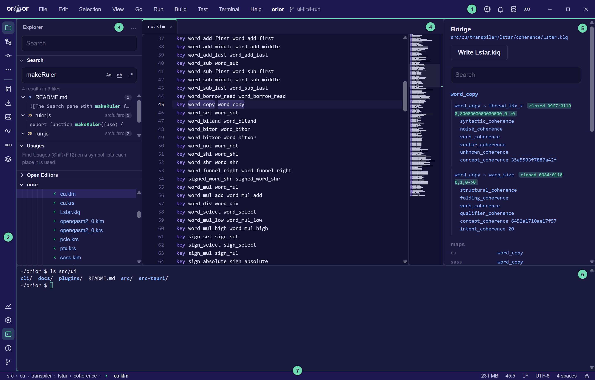

# Orior

An IDE, a transpiler and a search engine, written in C and CUDA. Every number in the engine is an exact integer.

[Setup](docs/setup.md) · [The app](docs/app.md) · [Using it](docs/usage.md) · [The algorithm](docs/method.md) · [The engine](docs/engine.md) · [Areas of research](docs/research.md) · [Licensing](docs/licensing.md)



## Components

### 1. IDE (C)

- **impero** ([`ui/cli/`](ui/cli)) is the command-line IDE and the library the GUI links. It is standalone and vectorized, and targets Windows, macOS, Linux and other POSIX systems, including AArch64 with NEON. Memory and CPU use: measurement pending.
- **tabvla** ([`ui/gui/src/`](ui/gui/src)) is the GUI: a native window in C on Windows and on Linux under X11, with impero built in. It is standalone and is driven by the same commands as impero, which it also shows the user as menu actions. impero holds every command, all state and all memory and draws each frame on a thread of its own ([`ui/cli/src/view/`](ui/cli/src/view)). The editor is the center of the window. The Rust and JavaScript under [`ui/gui/`](ui/gui) stay until tabvla matches them 1:1.

Build and verification:

- Every CLI module is unit tested and fuzzed with Unity.
- Hot paths are compared across toolchains (Clang/LLVM, GCC, cc) through disassembly to IR, toolchain dumps and Ghidra.
- Binary behavior is verifiable end to end for a target platform, statically and in execution:
  1. Static analysis: the binary is represented as flat binary relations.
  2. Hardware execution: an empty vendor container is the sandbox. Any part of a binary can be injected into it to check how the platform executes it.
  3. Combining the two with the toolchain comparison gives an end-to-end differential of the IR for each target platform, and checks execution on the target when the hardware is available.
  4. This lowers the risk of damaging expensive hardware with an unforeseen bug. Functional safety and aerospace use the same approach.

Editor model: a project is held as a tree, with the filesystem as the trunk and files as the branches. Grammar and syntax rules are assigned to branch nodes once, during the tree walk, and again only when a file changes or is saved and rejoins the tree through a FIFO write scheduler. Highlighting is drawn before the text appears.

Performance against other IDEs, Vim and Neovim (highlighting time, copy and paste cold and hot, from the OS and within orior): measurement pending.

### 2. Transpiler (C, CUDA, C++)

Depends on impero.

- **Zero-trust sealing**, for data integrity:
  1. The whole codebase can be sealed with a BLAKE3 hash per line, accumulated into a 32-word Merkle DAG root.
  2. The vendor container can be sealed to run only under that root, which makes the execution pipeline zero-trust.
  3. Signature files are small, archivable, and can be regenerated independently by anyone.
  4. A signature file gives anyone after-the-fact verification with any tool that reads a TSV of BLAKE3 hashes and the DAG. For example, a certifying body can disassemble a medical device, fingerprint its binaries, and compare that fingerprint 1:1 with the signature file registered with them.
- **Any language to any language.** A language is defined by a grammar TSV following the TSV format in [`src/lng/`](src/lng).
- **VHDL** verification with Yosys and GHDL.
- **SASS**: native, resident, streaming (context reuse), for any architecture.
- **Streaming**: gsm streamed into the vendor container and transpiled on the fly.
- **L\* query protocol**: Angluin's L\* plus orior's U\* (unknown coherence), the overseer and the conference. U\*, the overseer and the conference turn the minimally adequate teacher (MAT) into a reinforcement feedback loop.
- **Vendor container** ([`src/cu/transpiler/vendor_bin_layouts/`](src/cu/transpiler/vendor_bin_layouts)): an empty vendor binary layout, ready for machine code injection on the fly.
- **gsm**, gnascor assembly: pure relational binary assembly (1,1→2; 0,1→1; 1,0→1; 0,0→0; 2,2→3 for uncertainty), written as mnemonics. The table, the mnemonic definitions and the higher-order operators are in [`src/lng/gnascor_asm_lng.tsv`](src/lng/gnascor_asm_lng.tsv).
- **g**, the gnascor high-order language: mnemonic, in [`src/lng/gnascor_hol_lng.tsv`](src/lng/gnascor_hol_lng.tsv).

[The language: gnascor](docs/gnascor.md) covers both and the query protocol.

### 3. Engine (C, CUDA, C++)

**Ingest**

- **Compression** approaches the information content of the data by separating out its noise, using a fixed set of reproducible, fully random noise types, N\* = {pink, Poisson, photon, Johnson–Nyquist, ...}. See [Compression](theory/workbooks/compression).
- **File ECC**: obsignatio seals every file with a BLAKE3 hash per line, accumulated into a 32-word Merkle DAG. The signature file holds the line hashes, so any flipped bit is detected, traced to the line whose hash no longer matches, and healed there. The compression depends on this: data stored in a lattice after its noise is removed needs error correction that is close to perfect. BLAKE3's 256-bit output makes a missed error, two different lines with the same hash, negligibly likely, and the per-line hashes locate the error to its line. The seal does not depend on BLAKE3: a longer, newer or stronger hash can replace it, and the chance of a missed error falls as the hash gets longer. The signature file is written beside the file and can be regenerated with any tool that reads a table of BLAKE3 hashes. See [`src/cu/engine/runtime/obsignatio/`](src/cu/engine/runtime/obsignatio).
- **Storage**: the base storage class is the Atom (n·n^n^n virtual bytes). The data sets its own bounds, so nothing is truncated. What does not fit in memory stays on disk and is read through a window.

**Runtime**

- **membrane**: the vendor container, with an optional Merkle DAG seal.
- **tessera**: the job scheduler, which deploys ribosomes.
- **ribosomes**: native programs the engine emits. A ribosome is called a nucleus once it is inside the membrane.
- **engine**: forms questions as ribosomes and emits them into the membrane.

**Search**: the [sift](docs/sift.md), the [permutation null](docs/method.md) and shift agreement.

The engine measures the structure in an object against a permutation null: it retains the object's counts, shuffles their order, and measures what the shuffle destroyed, with nothing rounded, estimated or trained. The transpiler compiles a program written in [gnascor](docs/gnascor.md) into each target language. Angluin's L\*, with U\*, the overseer and the conference, works out the definitions of a target that nobody has described.

What the work claims, what it does not claim, and the results are on the [home page of the docs](docs/index.md). [Areas of research](docs/research.md) has every result, including the ones that failed, and [Where to start reading](docs/research_papers.md) lists the twenty-four research papers.

## Build

You need CMake and Ninja, a C11 compiler for the engine, and Clang for the CLI and tabvla, with `llvm-rc` on Windows and the X11 headers on Linux. [Setup](docs/setup.md) has the details.

```sh
git clone --recurse-submodules https://github.com/dstroy0/orior.git && cd orior
utils/maint/engine/build_engine.sh  # the C engine: configure, build, run the graders
ui/cli/build.sh                     # impero, into build/cli/<target>/
ui/cli/build.sh window              # tabvla, into build/cli/<target>/
```

On Windows PowerShell, the engine builds with `utils/maint/engine/build_engine.ps1`, and the CLI and tabvla build under Git's bash. [The app](docs/app.md) covers using the IDE.

## Documentation

| page                                                    | what it covers                                                                    |
| ------------------------------------------------------- | --------------------------------------------------------------------------------- |
| [Setup](docs/setup.md)                                  | dependencies, building the C engine, building the search kernel with no build system |
| [The app](docs/app.md)                                  | the IDE window and its command line                                               |
| [Using it](docs/usage.md)                               | running the measure on your own data, the six parts, and a C call to the search kernel |
| [The algorithm](docs/method.md)                         | the one construction, the six parts, and why nothing is bounded or tuned          |
| [The engine](docs/engine.md)                            | the parts and their status, the files, the compression floor and the transforms   |
| [The language: gnascor](docs/gnascor.md)                | the internal language, the query protocol, and the transpiler                     |
| [The sift](docs/sift.md)                                | the search kernel, what each grader answers, and the renderer                     |
| [Why the count is exact](docs/ENGINE_PROOF.md)          | the proofs that every probe set returns the exact count                           |
| [What those proofs license](docs/ENGINE_DIRECTIONS.md)  | searching an encoded corpus, searching by equality pattern, and planning from the census alone |
| [Areas of research](docs/research.md)                   | what came back from each subject, and every row that failed                       |
| [Where to start reading](docs/research_papers.md)       | the twenty-four research papers, each with what it holds                          |
| [The conditions of use](docs/condition_of_use.md)       | language, closed material, naming a writer, the scan of a patient, systems you do not own |

## Contributing and security

See [CONTRIBUTING.md](CONTRIBUTING.md) and [SECURITY.md](SECURITY.md).

## Licensing

It will always be free to use under the AGPL. A negotiated commercial contract and an educator's license are the other two, and each binds whoever signs it to every condition of use. [Licensing](docs/licensing.md) says which governs a use.

**Author:** dstroy0 (Douglas Quigg) <dquigg123@gmail.com>
