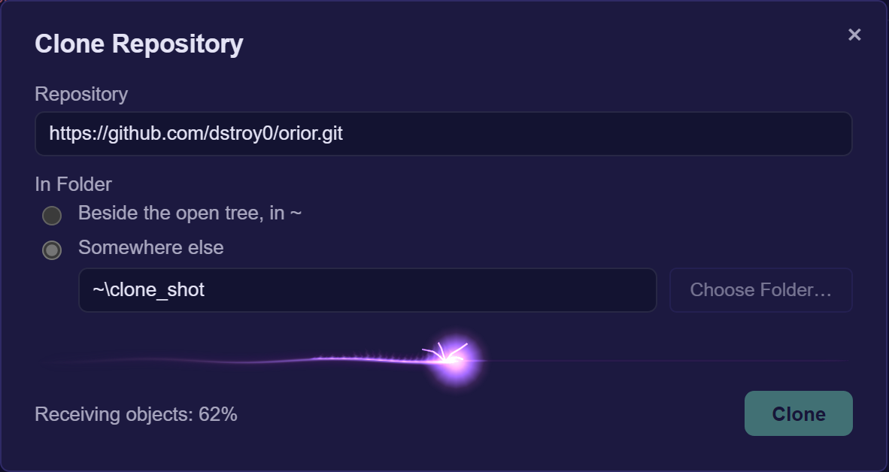
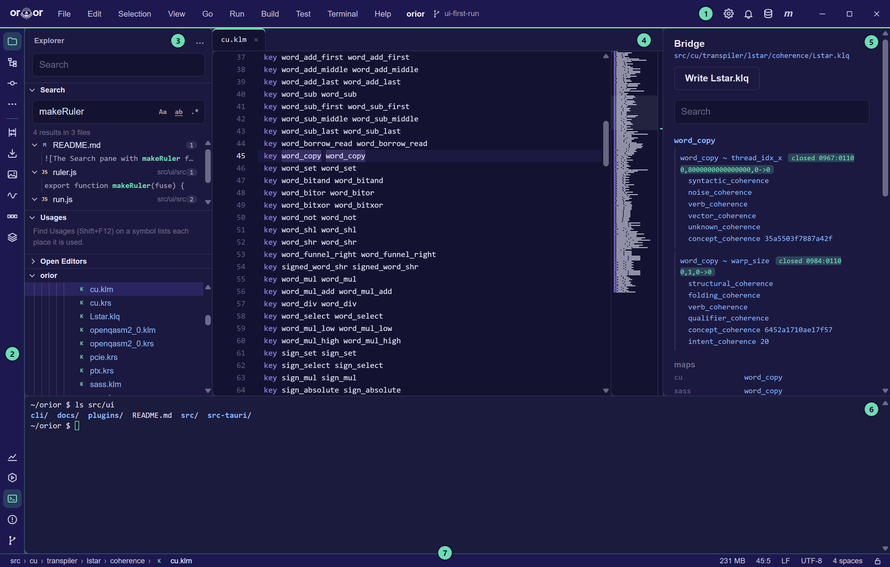
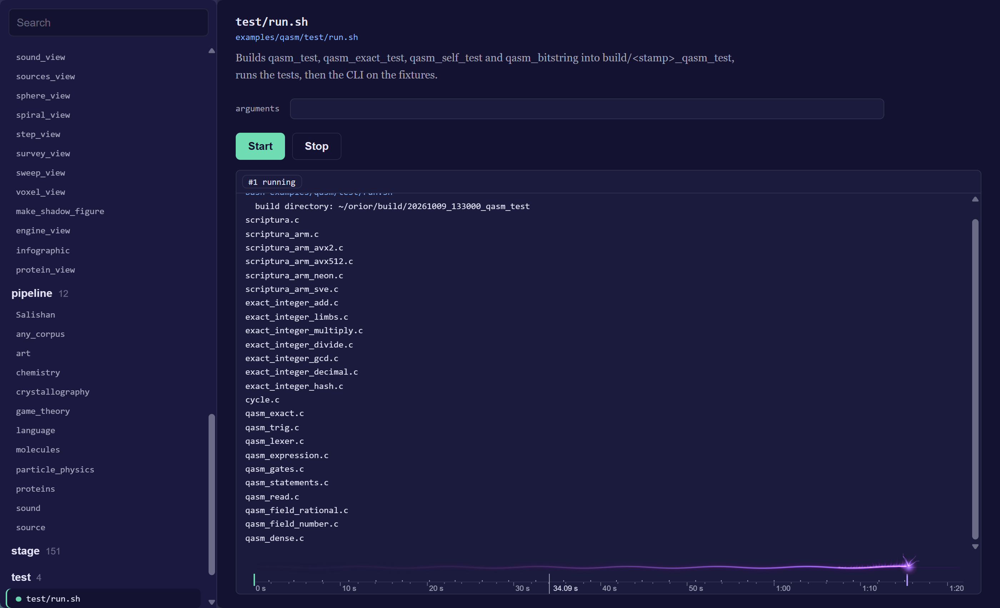
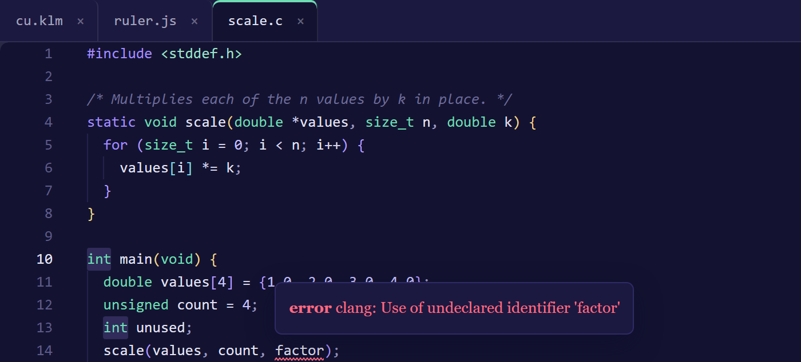
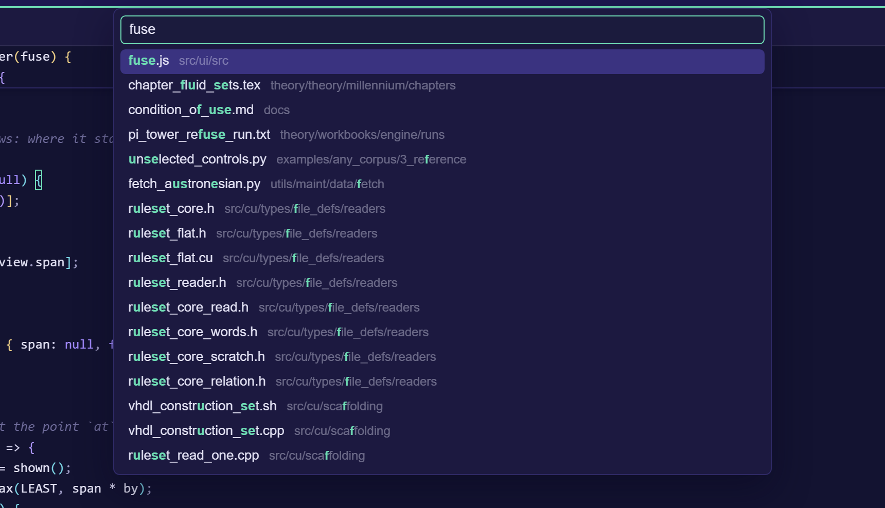
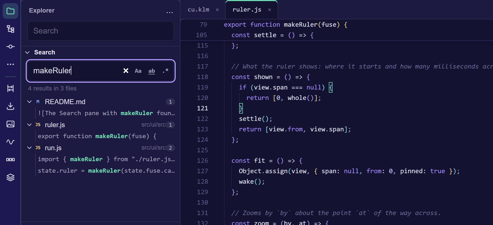
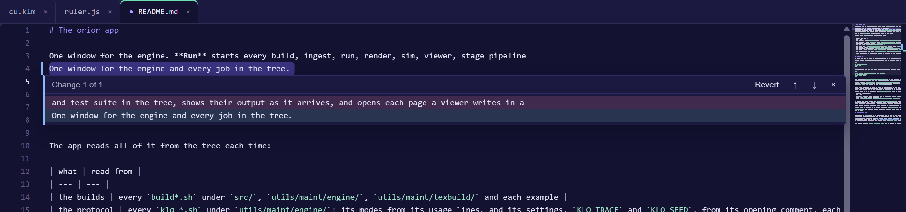
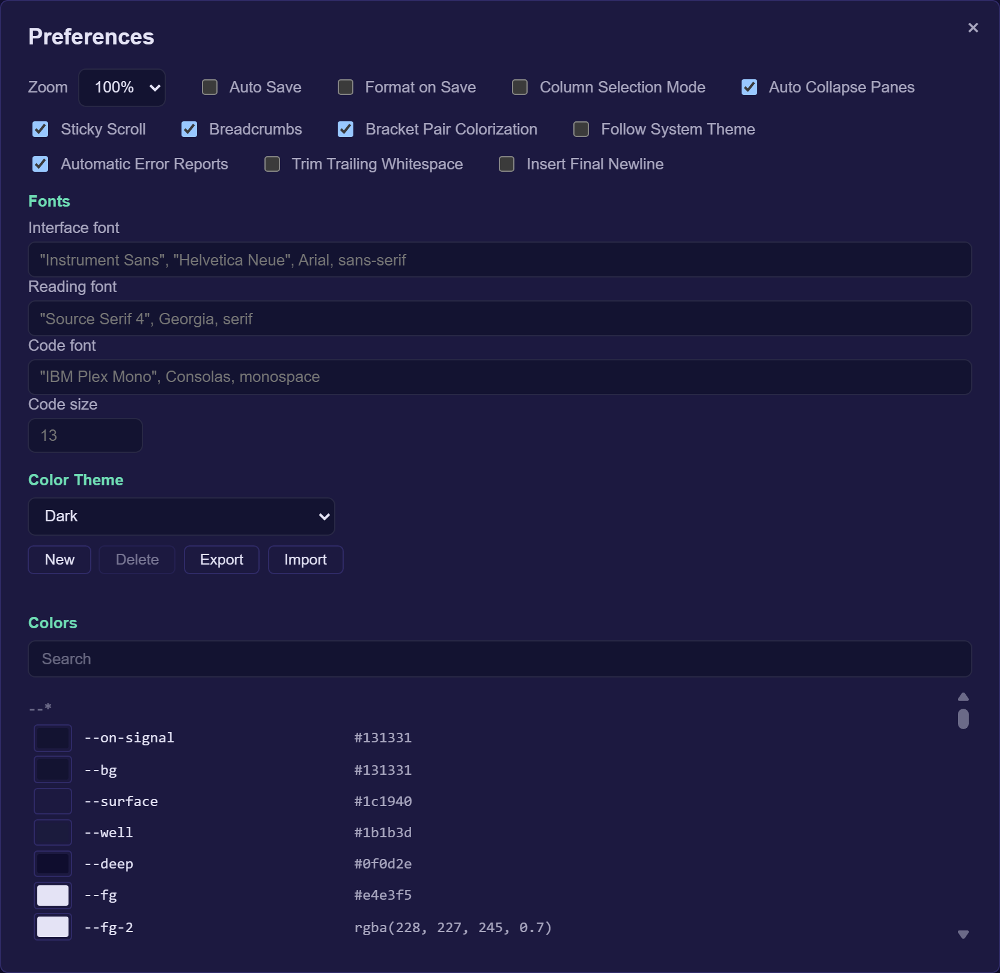
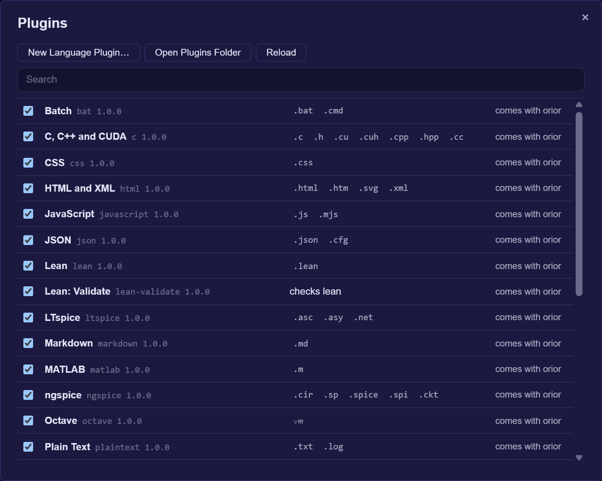
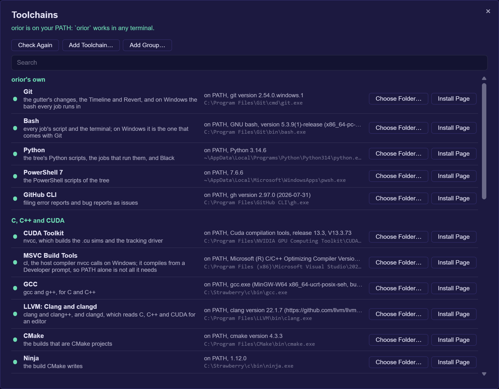

# The app

`orior` is one program with two faces: a window that runs every job in the tree and edits its files, and a command line over the same jobs. Most of what follows is done from the window, and every menu command is a word at the command line as well.

## Get started

1. **Install orior.** [The latest release](https://github.com/dstroy0/orior/releases/latest) has an installer for each system: the `setup.exe` or the `.msi` on Windows, the `.dmg` on macOS, and the `.deb`, the `.rpm` or the `.AppImage` on Linux. With Rust 1.85 or later, one command builds and installs it instead:

    ```sh
    cargo install --git https://github.com/dstroy0/orior orior_gui --locked
    ```

    The installers are not signed. Windows warns before the first run; choose More info, then Run anyway. On macOS, right-click the app and choose Open the first time.

2. **Open it and clone orior.** Started outside a tree, orior offers Open and Clone Repository. Clone Repository already holds orior's own address: choose the folder the clone goes in and press Clone. The window opens on the tree when the clone is done. It needs [git](https://git-scm.com/downloads), and on Windows, Git for Windows, whose bash the jobs run in.

    

3. **Run a job.** The Run view, from the chart icon at the foot of the tool strip, lists every job. Choose one, set its values and press F5.

In a clone, it also runs with no install. Every cargo build runs from the top of the tree and lands in `build/cargo/`:

```sh
cargo run --release --manifest-path ui/gui/src-tauri/Cargo.toml                  # build it and open the window
cargo run --release --manifest-path ui/gui/src-tauri/Cargo.toml -- run list      # the same program given words
```

The window works on the tree it starts in, or the one `ORIOR_ROOT` names. Started anywhere else, it offers Open and Clone Repository, and File, Open, Folder and File, Clone Repository move it to another tree at any time. Each tree keeps its own open tabs.

| File | holds |
| --- | --- |
| Create | File (Ctrl+N) and Folder, each named by its path from the tree's top, the open file's folder to start with; and Repository, which asks whether git makes it here in the open tree or in a folder chosen |
| Open | File (Ctrl+O), a file of the tree from the system's picker; Folder, another tree; and Repository, an address that is cloned into orior's own folder and opened, or opened as it is where it was cloned before |
| Clone Repository | an address and the folder its clone goes in: beside the open tree, or somewhere else |

[The app's own page](https://github.com/dstroy0/orior/blob/main/ui/README.md) covers the installers, what each platform needs, and where the window reads each job from.

## The window



| | part | what it holds |
| --- | --- | --- |
| 1 | Top bar | File, Edit, Selection, View, Go and Run, the Build and Test jobs, Terminal and Help, then the tree's name and its branch, with a star where a file differs from the last commit. At its right end Preferences, Notifications, which keeps what the status bar has said, Toolchains, and m, which shows or hides the definitions, then the window's own minimize, maximize and close. The bar is what the window moves by: a press on its empty middle drags it, and a double press maximizes or restores it. A key shown beside a command runs it from anywhere in the window. |
| 2 | Tool strip | an icon for each tool window down the left edge, the one open marked in signal; a press on it again closes it. The pointer resting on Explorer, Structure, Commit, Run, Problems or Git shows its pane from either view, a pointer only passing over the strip changing nothing. A press on the icon or in the pane keeps it; leaving the strip and the pane without one brings back the pane chosen before. At the top Explorer (the Edit view and its files, Ctrl+Shift+E), Structure (the open file's outline), Commit (the files that differ from the last commit, the Timeline and Local History), and more panes; under them, a line apart, the jobs of Protocol, Ingest, Render, Sim, Pipeline and Stage, each a menu beside its icon. At the foot Run (the Run view and its jobs, Ctrl+Shift+D), Debug, Terminal, Problems (the open files' diagnostics, marked while there are errors) and Git (the branch's commits). |
| 3 | Explorer | the panes of the icon chosen. For Explorer: Search, Usages, TODO, Open Editors and the tree's files. Its … menu shows or hides each pane. |
| 4 | Editor | a tab for each file, and the minimap down its right edge |
| 5 | Definitions | the definition of the open file's type, and in a coherence file, the bridge |
| 6 | Terminal (Ctrl+`) | a shell in the tree's top folder, under both views. What scrolls off its top goes to a file the system deletes when the app closes, and the window holds only the lines in sight and those just above the prompt, reading the rest back as it is scrolled to. |
| 7 | Status bar | the open file's breadcrumbs, its folders, it and the symbols the cursor is in; the runs going; the memory the app and every process it started hold, each part shown on hover. In the Edit view, the cursor's line:column, the selection, the line ends, the encoding, the indent, and a lock that makes the file read-only for as long as its tab is open. |

The panes at the sides collapse toward their edge a moment after the pointer leaves them, and the pointer at that edge brings them back. Ctrl+B shows or collapses the view's own pane, and View, Auto Collapse Panes keeps them open.

## Run a job

1. Choose Run at the foot of the tool strip (Ctrl+Shift+D), or open the menu for the kind of job: Build or Test on the top bar, or Protocol, Ingest, Render, Sim, Pipeline or Stage on the tool strip.
2. Choose the job. The arrow keys move through the list, and a job's description is the opening comment of its own file.
3. Set its values and press F5 to start it. Shift+F5 stops it.



The output streams as it comes. The fuse along its foot burns on the time ruler under it, its head at the run's latest moment, and it flashes when the run ends well and sputters dark when it fails or is stopped. The ruler marks where each step started and where the output came, red where it went to stderr. The wheel over either one, or + and - with the ruler holding the keys, zooms the time down to a few milliseconds across; a drag or Left and Right moves it, and 0 or a double click fits the whole run again. A page a viewer writes opens in a window of its own.

## Edit a file

Open a file from the tree, from Go to File (Ctrl+P), or from the command line with `orior <file>:<line>:<column>`. The editor colors `.g`, `.gsm`, the k-files and every language under `src/lng/`, and shows the type's definition beside the file. In a file of `src/cu/transpiler/lstar/protocol/table/`, the bridge shows beside it: for the key under the cursor, its pairs and their verdicts, its name in each language and each ruleset's entry, every line a click from its file. A file that is not text opens as its bytes, and a file too large to read whole opens at the line it was left at and reads outward from there.

| to | do this |
| --- | --- |
| complete the word at the cursor | Ctrl+Space; a hover over a word shows what it means |
| add a cursor | Ctrl+Alt+Up or Ctrl+Alt+Down; Ctrl+D adds the next occurrence of the selection, Ctrl+Shift+L every one |
| select a column | drag with Shift+Alt pressed, or turn on Selection, Column Selection Mode and drag |
| move or copy lines | Alt+Up and Alt+Down move them; Shift+Alt+Up and Shift+Alt+Down copy them |
| rework lines | Selection holds Join Lines (Ctrl+J), Sort Lines Ascending and Descending, Delete Duplicate Lines, and the case changes. With nothing selected, sorting and duplicates take the whole text and a case change takes the word at the cursor. |
| comment lines | Ctrl+/ |
| format the file | Shift+Alt+F, or Edit, Format Document: Black for Python, clang-format for C, C++ and CUDA, rustfmt for Rust, Prettier for JavaScript, CSS, HTML, JSON, Markdown and YAML. Each keeps to the project's own pyproject.toml, .clang-format, rustfmt.toml or .prettierrc, and one undo takes it back. |
| run the file | Ctrl+F5, or Run, Run File: it is saved, then runs in the terminal with its language's toolchain. Python, R, Ruby, JavaScript, the shells and PowerShell run as scripts; MATLAB runs with -batch, or in Octave where MATLAB is not installed; Lean with lean --run, TeX with latexmk, netlists with ngspice or LTspice, VHDL with GHDL; C, C++, CUDA and Rust are compiled to build/run/ and run. |
| fold | the arrow in the gutter; Ctrl+K Ctrl+0 folds everything and Ctrl+K Ctrl+J unfolds it |
| grow the selection | Shift+Alt+Right takes in the word, then the string or brackets around it, the line and each block out from there; Shift+Alt+Left gives each step back |
| see a file twice | View, Split Right (Ctrl+\) or Split Down, or a tab's menu: a second editor on the file beside the first or under it, the text the same in both and the cursor and place each its own. The menus act on the one last pressed in. View, Unsplit, the × over it, or closing the file's tab closes it. |

In C, C++ and CUDA the editor asks clangd, from File, Toolchains, what the code means; in Rust it asks rust-analyzer, and in Python Pyright. A wavy line marks each error in red and each warning in yellow, and a hover over it says what is wrong; the tool strip's Problems lists them, and F8 and Shift+F8 step to the next and the previous. A hover over a name shows its type and its declaration, Ctrl+Space completes from what the code declares, and F12 or a click with Ctrl pressed goes to a definition.

| to | press |
| --- | --- |
| list every place a name is used | Shift+F12 or Alt+F7, Go, Find Usages: the explorer's Usages pane lists them by file. A language with no server is searched for the name as a whole word. |
| rename it everywhere | F2 or Shift+F6, Edit, Rename Symbol: type the new name over the old and press Enter. Open tabs change where undo takes it back, and files no tab holds are written. |
| fix what is marked | Ctrl+. or Alt+Enter, Edit, Quick Fix, or the bulb beside a marked line: the fixes and refactorings the server offers there. |
| see a call's parameters | Ctrl+Shift+Space, Edit, Parameter Info. It opens on its own as ( or , is typed in a call, the parameter the cursor is at in bold. |
| read a name's documentation | Ctrl+K Ctrl+I or Ctrl+Q, Edit, Quick Documentation |

## Commit, push and pull

Commit on the tool strip lists every file that differs from the last commit, each with a box that says whether the next commit takes it, and every box ticked until one is cleared. A press on a file shows its changes side by side over the editor, the last commit on the left; F7 and Shift+F7 step through them and Escape closes them. Under the files, the message, then Commit, or Commit and Push, which save the open files first and run the tree's own hooks and signing. Where git refuses, what it said shows under the buttons. The window's bar reads the tree again, rolls the files taken back to the last commit after a second press, pulls only where nothing would merge, and pushes, beside how many commits the branch is behind and ahead of its remote. Git on the strip lists the branch's commits.

## Debug a file

Run, Debug File (Shift+F9) runs the file in the editor under its language's debugger: lldb-dap for C, C++ and Rust, built first with clang or rustc into build/debug/, gdb on Linux and macOS, and debugpy for Python. A press in the gutter's strip left of a line's number, or F9, sets a breakpoint there, and the dot is hollow where the debugger could not bind it to code. Where the program stops, its file opens at the line, marked until it runs on, and the Debug window under the editor (View, Debug, Alt+5) shows the calls in Frames, the chosen frame's variables and the watches in Variables, and the program's output in Console, whose field evaluates in that frame.

| to | press |
| --- | --- |
| continue | F5 |
| step over, into, out | F10; F11 or F7; Shift+F11 |
| pause | F6 |
| stop, or start again | Shift+F5 or Ctrl+F2; Ctrl+Shift+F5 |

lldb-dap from the LLVM release loads Python 3.11's library, and orior gives it the folder Python 3.11 installs to; File, Toolchains says what is missing where it does not start. debugpy goes into the Python orior uses with `python -m pip install debugpy`.



clangd reads the flags each file is compiled with from `build/compile_commands.json`, which `python -I utils/maint/engine/clangd_database.py` writes; run it once after a clone and again after a file is added or moved.

## Check a Lean proof

A proof can fail for a reason that is not in its mathematics: Lean stops an elaboration that takes too many heartbeats, recurs too deep or runs out of stack, and the error reads like any other. Run, Validate (Ctrl+Alt+F5) checks the Lean file in the editor and tells the two apart. Where Lean stops at a limit, the file is checked again with that limit raised, step by step up to a ceiling, until it goes through or stops for another reason. A `set_option` in the file is raised with it. The file itself is not changed; the checks run on a copy beside it, deleted after.

| marked | means |
| --- | --- |
| math | an error Lean reports with every limit raised: the proof is wrong as written |
| barrier | a limit stopped Lean here; the hover says the setting it goes through at, or that it still stops at the ceiling |
| axiom | a theorem rests on an axiom past `propext`, `Classical.choice` and `Quot.sound`: `sorryAx` from a `sorry`, or the answer of compiled code that `native_decide` took |
| flag | a place where an exact number is carried in a type that can lose it, such as `Float` or `UInt64`, or where compiled code stands in for the definition the proof reads |

Each one shows in the editor as a wave with its hover, and the status bar says whether the file holds and at which settings. Inside a Lake project, found by its `lakefile.lean`, `lakefile.toml` or `lean-toolchain`, the file is checked with `lake env lean`. `orior run validate <file>...` does the same from the command line and exits 1 when a file does not hold; `--json` prints the report.

View turns on and off Sticky Scroll, which holds the opening line of each block the top of the screen is inside; Breadcrumbs, the folders, the file and the symbols the cursor is inside, each a click from where it points; and Bracket Pair Colorization, each pair of brackets colored by its depth.

Ctrl+S saves the file shown and File, Save All saves every one. File, Auto Save saves each file a moment after it changes. File, Format on Save formats each file as Ctrl+S or Save All writes it, though not as Auto Save does; a formatter that fails says why on the status bar and the file is written as it was. A tab with changes not yet saved asks for a second click before it closes. Closing the app with changes open keeps them: they come back, still unsaved, the next time the tree opens.

## Find your way



| to go to | press |
| --- | --- |
| anything | Shift twice, Go, Search Everywhere: files, the open file's symbols and commands, each under its heading |
| a file | Ctrl+P, then part of its name. `path:line:column` goes to a place in it, and the files opened last come first. |
| a file opened lately | Ctrl+E, Go, Recent Files |
| a line marked | Ctrl+F11, Go, Toggle Bookmark, marks the cursor's line with a ribbon in the gutter; Ctrl+Shift+F11, Go, Bookmarks, lists every line marked in the tree, each a press from its place |
| a command | Ctrl+Shift+P, or `>` in Go to File |
| a symbol in the file | Ctrl+Shift+O, or `@` in Go to File. The Outline pane lists them all. |
| a line | Ctrl+G, or `:` in Go to File |
| the matching bracket | Ctrl+Shift+\ |
| a definition, in C, C++ and CUDA | F12, or a click with Ctrl pressed |
| the next error or warning | F8, and Shift+F8 for the one before |
| where the cursor was | Alt+Left, and Alt+Right to come back |
| the tab shown last | Ctrl+Tab; hold Ctrl and press Tab again to step further back |

## Search

Ctrl+F finds in the file and Ctrl+H replaces, with F3 and Shift+F3 for the next and the previous match. Ctrl+Shift+F opens Find in Files, the explorer's Search pane: case, whole words and regular expressions each turn on beside the field, each file's row holds its count, and a line's row opens the file at the match. `orior edit search <text>` searches the tree from the command line.



## Version control

The tree colors each file's name by how it differs from the last commit, with git's letter after it. A folder holding a changed file takes that file's color with a dot, and what the ignore files leave out is dimmed.

In the editor, the gutter marks each line added or changed since the last commit, and each place lines were taken out. A click on a mark shows the change under it: the lines the commit had and the lines there now. Revert puts the commit's lines back as one edit, which Ctrl+Z takes back. Alt+F5 and Shift+Alt+F5 step to the next and the previous change. The strip down the minimap's right edge marks the whole file at once, the changes in one lane and find's matches and the cursors in the other, and a click on it goes there.



The Timeline pane lists the commits that touched the open file. Open shows the file as a commit left it, read only, in a tab of its own.

Local History, under Commit on the tool strip, lists the open file as each save left it, newest first, with the text it contained before the first of them. orior keeps these in its own folder, apart from git, the newest hundred of each file. A press on one shows it beside the file as it stands, and Revert to This in its menu puts it back as one edit, which Ctrl+Z takes back.

TODO, in the Explorer's … menu, lists every TODO, FIXME, XXX and HACK in the tree as a whole word, by file, each line a press from its place.

## Settings and themes

File, Preferences (Ctrl+,) holds the zoom, every setting the menus turn on and off, Trim Trailing Whitespace and Insert Final Newline on save, the fonts and the colors. Ctrl+=, Ctrl+- and Ctrl+0 zoom in, out and back. View switches between light and dark, and View, Follow System Theme takes the scheme from the system, changing as it does.

To make a theme of your own, choose Light or Dark under Color Theme and press New. Each color of the palette is then yours to change, from the editor's and the menu bar's to the eye's, the fuse's and the lattice's; Search narrows the list, and ↺ puts one color back. Export copies the theme to the clipboard, and Import reads one from it. Themes are kept between runs and the one chosen shows from the first frame.



File, User Stylesheet opens `user.css` in orior's own folder, making it first where it is not there. Any rule of CSS in it lays over the app's own, and every color and font above is a variable named as Preferences lists it: `:root[data-scheme] { --fuse-fire: #ff7a1a; }` sets the fuse's flame in both schemes. The window reads the file again each time it comes back to the front.

orior's own folder is `%APPDATA%\orior` on Windows and `~/.config/orior` elsewhere, or the folder `ORIOR_HOME` names.

## Languages and plugins

Each language the editor colors is a plugin. orior comes with plugins for MATLAB, Octave, R, Python, C, C++ and CUDA, Rust, JavaScript, Lean, VHDL, SHARC assembly, LTspice, ngspice, TeX, Markdown, HTML and XML, CSS, JSON, TOML, YAML, the shells and plain text. A plugin is a folder with a `plugin.json` that names the extensions it opens, its comments, brackets and quotes, a grammar, and the words and snippets it completes. File, Plugins lists every plugin with what it opens, turns each on or off, and shows what is wrong with one that does not read. Your own plugins go in `plugins` in orior's own folder; Open Plugins Folder opens it, and Reload reads them again. One of yours with the id of one that comes with orior is used in its place. Where two plugins name one extension, as MATLAB and Octave both name `.m`, yours comes first, then the first by id; the list strikes out an extension another plugin opens, and turning that plugin off hands it on.



File, New Language Plugin asks for a name, the extensions, the comments, the keywords, the types, the constants and the quotes, or starts from a plugin there already. A sample on the right shows how the plugin colors code as you type, over the `plugin.json` it will write. Create writes it to your plugins folder, with a sample file beside it, and the editor opens those extensions in it at once.

A plugin whose `kind` is `tool` adds a check to languages it names, in place of a language of its own. The Lean checker above is one: its `plugin.json` lists each limit with the words Lean stops with, the option that raises it, its default and its ceiling, then the words to flag and the axioms to trust. File, Plugins shows such a plugin with the languages it checks.

## Toolchains

orior installs no compiler or language of its own. File, Toolchains lists each one the tree and the app use, from Git, Bash and Python through CUDA, MSVC, GCC, LLVM, Rust, Node.js, Ruby, R, MATLAB, Octave, Lean, TeX, ngspice, LTspice, GHDL and CrossCore Embedded Studio to the formatters Black, clang-format and Prettier, with what each is for, where orior found it and the version it says.



| shown | means | what you can do |
| --- | --- | --- |
| on PATH | found on your PATH | Choose Folder to use another copy |
| installed, not on PATH | found where it usually installs | Add to PATH, or Use This Folder |
| not found | not on your PATH or in its usual folders | Install Page opens its makers' download page; Choose Folder takes its `bin` folder. For Lean, Install runs elan's installer in the terminal. |
| from your folder | orior runs it from the folder you gave | Forget Folder |

Every job needs Git, Bash and Python. As a tree opens, the status bar names any of them orior cannot find, and a press on it opens File, Toolchains.

The list takes toolchains and groups of your own. Add Toolchain asks for its name, its group, one there already or a new one, what it is for, the programs it runs as, the words that make it say its version, and its install page; orior then finds it and offers it as it does its own. Add Group adds a group that stands empty until a toolchain goes in it. Remove on a toolchain you added, and Remove Group on an empty group, take them out again; orior's own stay. They are kept in `user_toolchains.json` in orior's own folder, each written as orior's own `toolchains.json` writes one. A field the sheet does not ask for, such as how a file runs or the language server it starts, can be added there by hand. `orior file toolchains add <name> --group <group> --program <name,...>`, `add-group`, `remove` and `remove-group` do the same from a terminal.

Above the list, Add orior to PATH puts orior's own folder on your PATH, and `orior` then works in any terminal. On Windows a folder goes on your own Path in the registry, and its `%VARIABLES%` stay as written; elsewhere it is a line at the end of `~/.profile`. orior's runs and its terminal read the PATH anew each time and put the folders you gave first: a change shows there at once; a terminal opened before it does not have it. The folders you gave are kept in `toolchains.json` in orior's own folder.

## The terminal

Ctrl+` opens and closes the terminal, and Ctrl+Shift+` starts a new shell. Closing the panel leaves the shell running. Ctrl+C copies where text is selected and interrupts where none is; Ctrl+Shift+C copies and Ctrl+Shift+V pastes. Its top edge drags to set its height. Open in terminal, on a folder of the tree, starts a shell there.

## Keyboard shortcuts

| keys | does |
| --- | --- |
| Ctrl+Shift+P | Command Palette |
| Ctrl+P | Go to File |
| Ctrl+Shift+F | Find in Files |
| Ctrl+Shift+E, Ctrl+Shift+D | the Edit view, the Run view |
| F5, Shift+F5 | start the job, stop it |
| Ctrl+F5 | run the file |
| Ctrl+Alt+F5 | check a Lean proof |
| Ctrl+S | save |
| Shift+Alt+F | format the file |
| F12 | go to the definition |
| F8, Shift+F8 | the next error or warning, the one before |
| Ctrl+B | show or collapse the side pane |
| Ctrl+` | the terminal |
| Alt+Left, Alt+Right | back, forward |
| Ctrl+D | add the next occurrence |
| Alt+F5 | the next change since the last commit |
| Ctrl+, | Preferences |

Help, Keyboard Shortcuts lists every one, and `orior help keys` prints them.

## The command line

Given no words, `orior` opens the window. Given words, it runs them in the terminal: a menu's title and one of its commands. `orior help` lists every one, and a command marked `*` there acts in the window, opening it if it is closed.

```
orior run list [word]                   the jobs, or those whose id, title or about holds the word
orior run show <job>                    a job's file, values and the commands it runs
orior run <job> [key=value] [-- words]  run a job; a key given twice gives two values
orior run run-file <file>               run a file with its language's toolchain
orior run validate [--json] <file>...   check Lean proofs, lifting the limits Lean stops at
orior build [job]                       the build jobs, or one of them; each kind of job is a word
orior edit search [--case] [--word] [--regex] <text>
orior edit format [--check] <file>...   format files in place; --check names those that would change
orior go bridge [key]                   the keys of Lstar.klq, or one key's pairs, maps and rulesets
orior view scheme dark                  any window command, here switching to the dark scheme
orior file plugins                      every plugin, where it comes from and what it opens
orior file new-plugin <name> --ext <e>  write a language plugin; orior help names its other words
orior file user-css                     the path of user.css, made where it is not there
orior file clone [url] [folder]         clone a repository, orior's where none is named, into a folder
orior file toolchains                   each toolchain, where it was found and its version
orior file toolchains install <tool>    run its installer where orior has one, else open its install page
orior file toolchains add-path <tool>   put its folder on your PATH; add-path orior adds orior
orior file toolchains use <tool> <dir>  run a toolchain from a folder; forget <tool> drops it
orior <file>[:line[:column]]            open a file of the tree in the window
orior --completions <shell>             completions for bash, zsh, fish or powershell
```

`list`, `show` and `bridge` work alone as well. A job is named by its id, by the end of its id after a slash, or by its title, where that names only one: `orior run sim/noise_floor`, `orior run show noise_floor`. A run's output streams as it comes, and `orior` exits with the code of its last step.

To complete words as you type, load the script for your shell: `eval "$(orior --completions bash)"` in bash, `orior --completions fish | source` in fish, and `orior --completions powershell | Out-String | Invoke-Expression` in PowerShell.

| setting | names |
| --- | --- |
| `--root <folder>` | the tree to work on, ahead of `ORIOR_ROOT` |
| `ORIOR_ROOT` | the tree, ahead of the one the working folder or the program is in |
| `ORIOR_BASH`, `ORIOR_PYTHON` | the bash and the Python the jobs run with, where the ones on the path are not the ones to use |
| `ORIOR_NO_REPORTS` | no error reports for this run |
| `ORIOR_HOME` | orior's own folder, for the settings, the plugins and `user.css` |

## When something goes wrong

The app files the errors it meets as issues on dstroy0/orior, and asks once whether to. Help, Automatic Error Reports turns that on or off, and the status bar shows where each report went. Help, Report a Bug opens a form for a report of your own, and `orior help report` does the same from the command line.

**Author:** dstroy0 (Douglas Quigg) <dquigg123@gmail.com>
